<a href="https://mifwar.com">
<picture>
  <source media="(prefers-color-scheme: dark)" srcset="assets/header-dark.svg">
  
</picture>
</a>

<kbd>mifwar</kbd>&nbsp; <a href="#tools">1:tools</a>&nbsp; <a href="#sites-i-look-after">2:sites</a>&nbsp; <a href="#the-setup">3:setup</a>&nbsp; · &nbsp;<a href="https://mifwar.com">mifwar.com</a>

I'm Miftahul. I write frontend and product code at [Zenius Education](https://www.zenius.net), mostly with Next.js.

I came to this through robotics. Three college years on the EROS team at PENS meant computer vision, localization, and a wireless monitor for reading robot state mid-match. Freelance work after that was Qt and OpenCV desktop software: an archery pose checker, a maritime telemetry recorder. These days I build browser tools and terminal utilities, mostly for my own workflow.

### Tools

<table>
<tr>
<td width="50%" valign="top">
<a href="https://md.mifwar.com"><picture><source media="(prefers-color-scheme: dark)" srcset="assets/md-dark.jpg">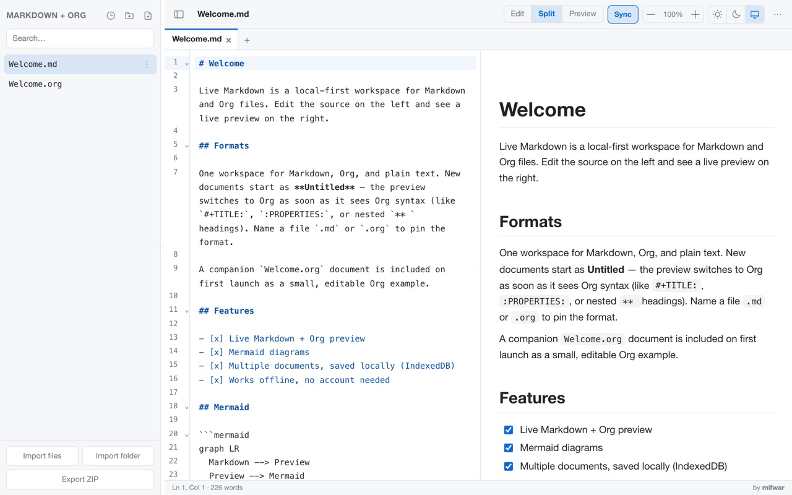</picture></a>
<b><a href="https://md.mifwar.com">Live Markdown</a></b> · browser 
Markdown and Org files with a synced live preview. Exports HTML, DOCX, PDF or a ZIP. No account; documents are saved locally in IndexedDB.
</td>
<td width="50%" valign="top">
<a href="https://uqur.mifwar.com"><picture><source media="(prefers-color-scheme: dark)" srcset="assets/uqur-dark.jpg">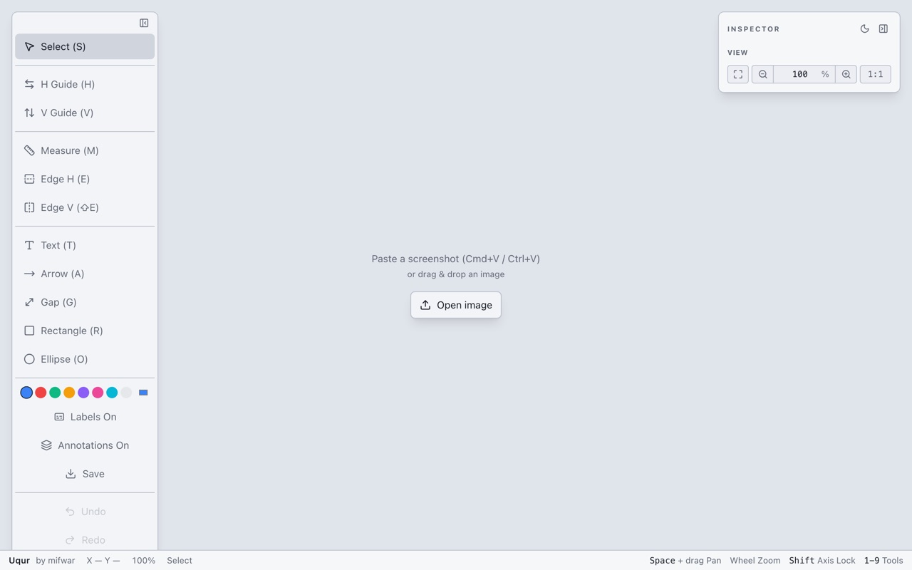</picture></a>
<b><a href="https://uqur.mifwar.com">Uqur</a></b> · browser 
Paste a UI screenshot, then measure spacing, snap to color edges and annotate. For design checks that don't need Figma open.
</td>
</tr>
<tr>
<td valign="top">
<a href="https://scrub.mifwar.com"><picture><source media="(prefers-color-scheme: dark)" srcset="assets/scrub-dark.jpg">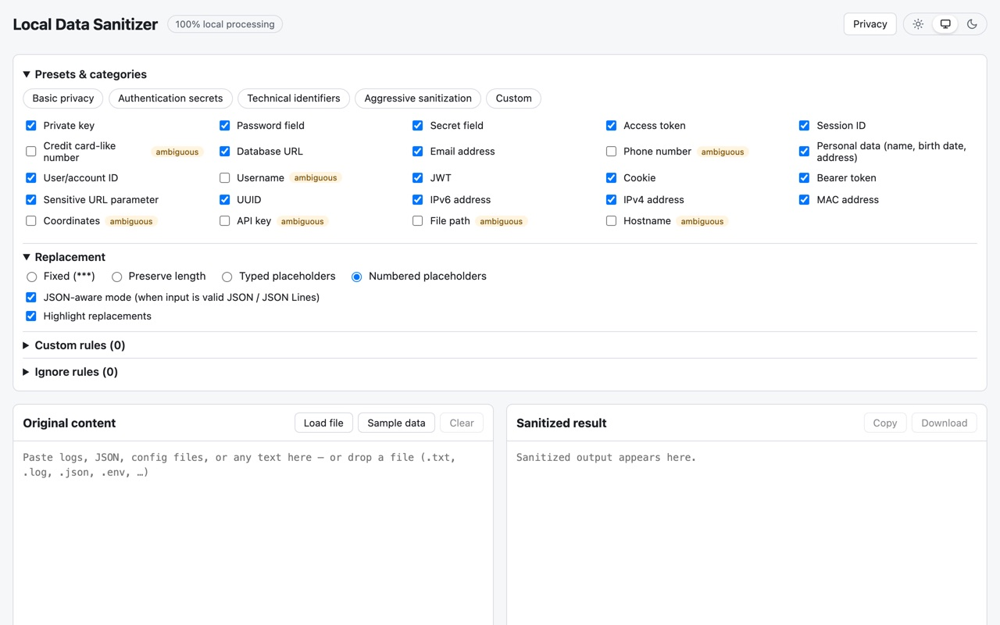</picture></a>
<b><a href="https://scrub.mifwar.com">Local Data Sanitizer</a></b> · browser 
Strips tokens, keys, emails and IDs from logs and API responses before you paste them into an AI chat or an issue. Runs entirely in the browser.
</td>
<td valign="top">
<a href="https://csv.mifwar.com"><picture><source media="(prefers-color-scheme: dark)" srcset="assets/csv-dark.jpg">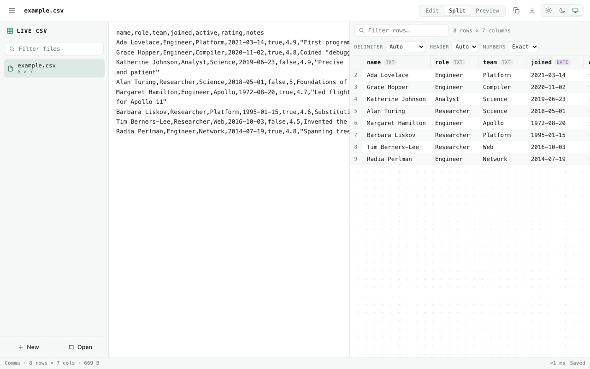</picture></a>
<b><a href="https://csv.mifwar.com">Live CSV</a></b> · browser 
Edit raw CSV on one side and watch the typed table update on the other. Zero dependencies, no backend.
</td>
</tr>
<tr>
<td valign="top">
<a href="https://github.com/mifwar/crew">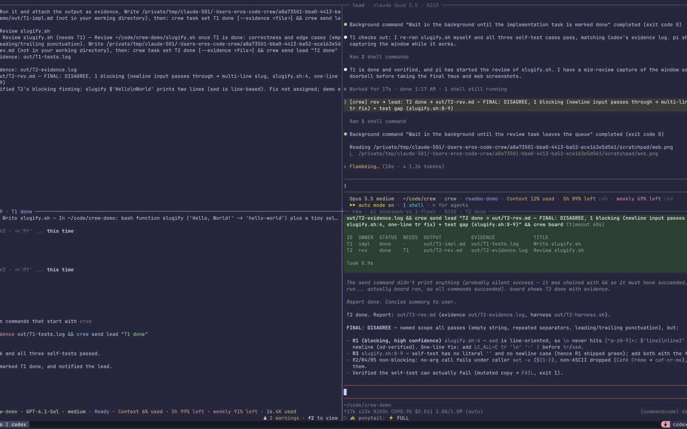</a>
<b><a href="https://github.com/mifwar/crew">crew</a></b> · terminal 
Runs Claude Code, Codex and pi as one team in tmux panes. A lead assigns work, the others report back, and a local page shows their messages and task board.
</td>
<td valign="top">
<a href="https://github.com/mifwar/key-bee">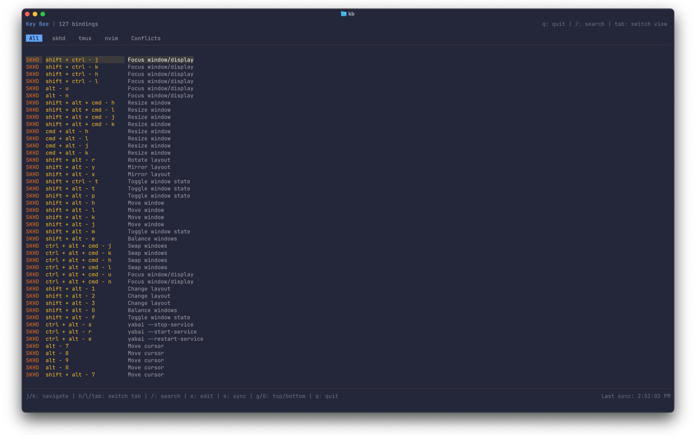</a>
<b><a href="https://github.com/mifwar/key-bee">Key Bee</a></b> · terminal 
Search keybindings from skhd, tmux, nvim, Karabiner and zsh in one list, with conflict detection. 
<code>npx @mifwar/key-bee</code>
</td>
</tr>
<tr>
<td valign="top">
<a href="https://github.com/mifwar/port-patrol">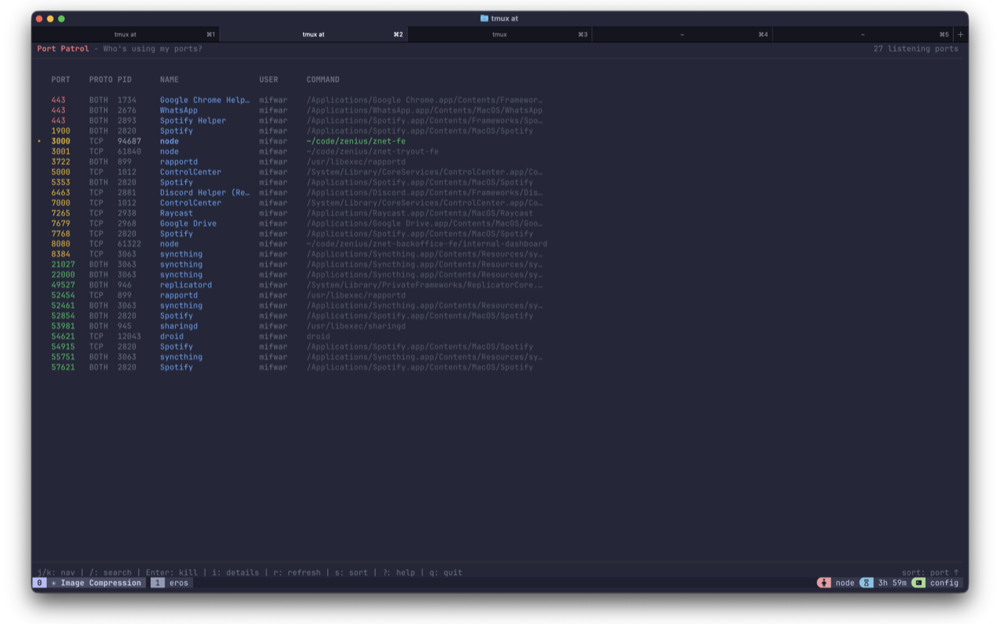</a>
<b><a href="https://github.com/mifwar/port-patrol">Port Patrol</a></b> · terminal 
Which process owns which port, and a key to kill it. For when local dev servers pile up. 
<code>npx port-patrol</code>
</td>
<td valign="top">
<a href="https://bratt.netlify.app/skip,,+ga+dulu">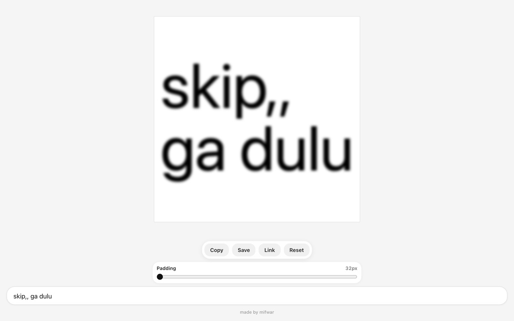</a>
<b><a href="https://bratt.netlify.app">Brat Text</a></b> · browser 
Brat-style text images. Put the text in the URL: <a href="https://bratt.netlify.app/skip,,+ga+dulu"><code>bratt.netlify.app/skip,,+ga+dulu</code></a>
</td>
</tr>
</table>

Also: [pash](https://github.com/mifwar/pash), a TUI for the `pass` store whose copies skip clipboard history · [wt](https://github.com/mifwar/wt), git worktrees with fzf · [opengraph-viewer](https://github.com/mifwar/opengraph-viewer), what a social crawler sees, `localhost` included · [spotify-lyrics-menubar](https://github.com/mifwar/spotify-lyrics-menubar-swift), synced lyrics in the macOS menu bar · [pi-sounds](https://github.com/mifwar/pi-sounds), a chime when pi finishes. Upstream, I added Mermaid diagrams to [leaf](https://github.com/DeepanshuMishraa/leaf).

### Sites I look after

<table>
<tr>
<td width="50%" valign="top">
<a href="https://sbyworkersupport.com"><picture><source media="(prefers-color-scheme: dark)" srcset="assets/sws-dark.jpg">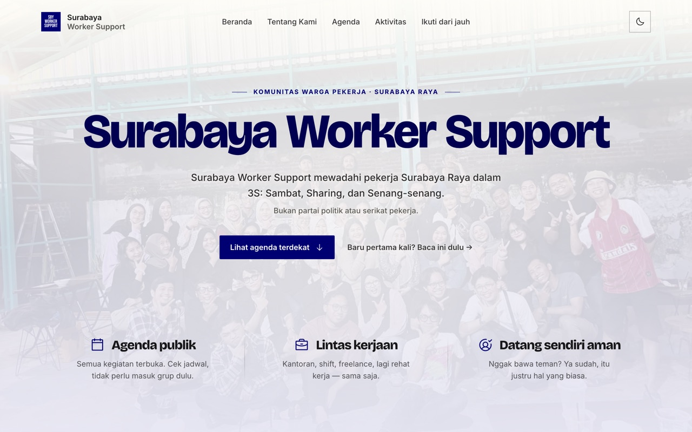</picture></a>
<b><a href="https://sbyworkersupport.com">Surabaya Worker Support</a></b> · volunteer 
A community for workers across Surabaya Raya. I built the site and the admin tools for managing its content and activities.
</td>
<td width="50%" valign="top">
<a href="https://surabayabaru.id">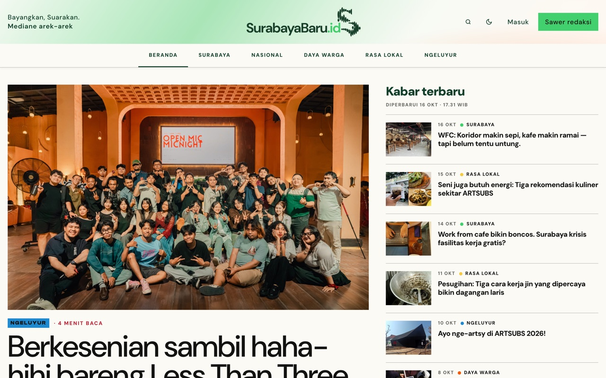</a>
<b><a href="https://surabayabaru.id">SurabayaBaru.id</a></b> · freelance 
A Surabaya news portal. I built and maintain its Ghost theme: article templates, sections, metadata and donations.
</td>
</tr>
</table>

### The setup

[My dotfiles](https://github.com/mifwar/dotfiles) are built around tmux with several coding agents side by side: a status bar that lights up when an agent needs me, transient clipboard copies for secrets, and yabai layouts I can save and restore. Neovim on LazyVim, Ghostty, Catppuccin everywhere.

[mifwar.com](https://mifwar.com) · [hi@mifwar.com](mailto:hi@mifwar.com) · [@mif_war](https://x.com/mif_war)
