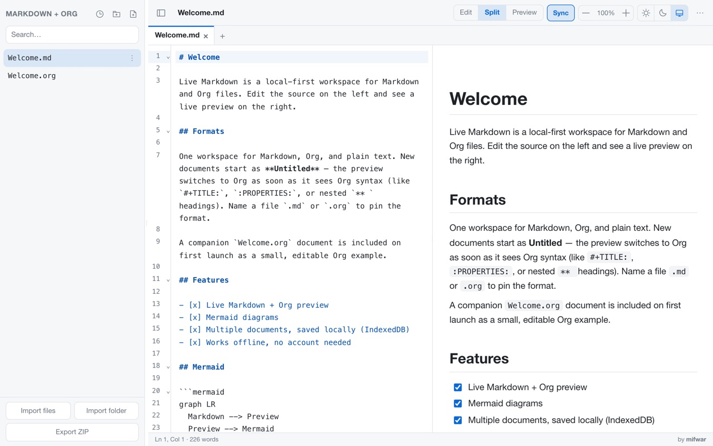
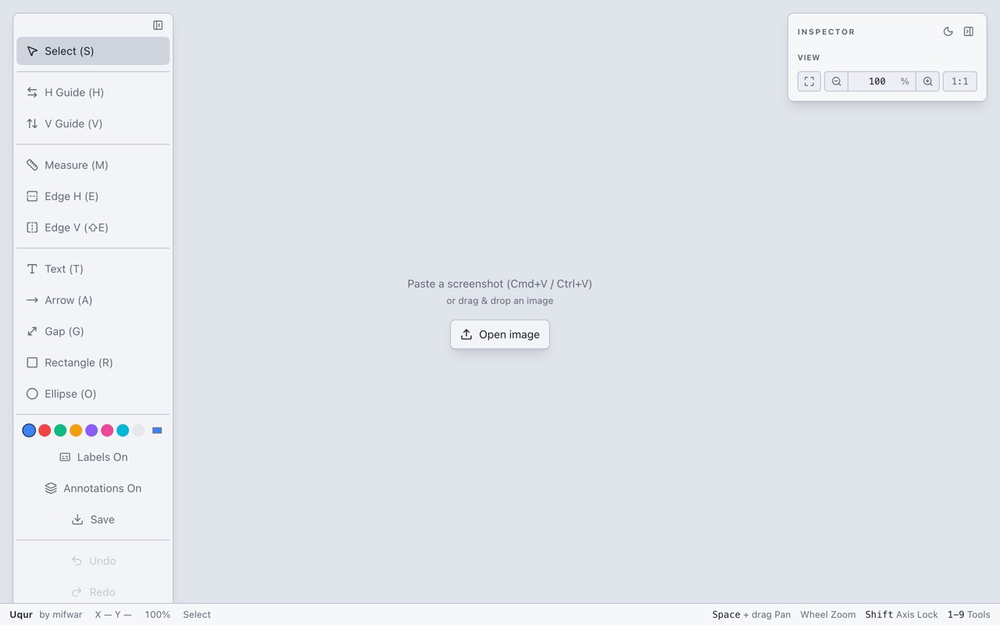
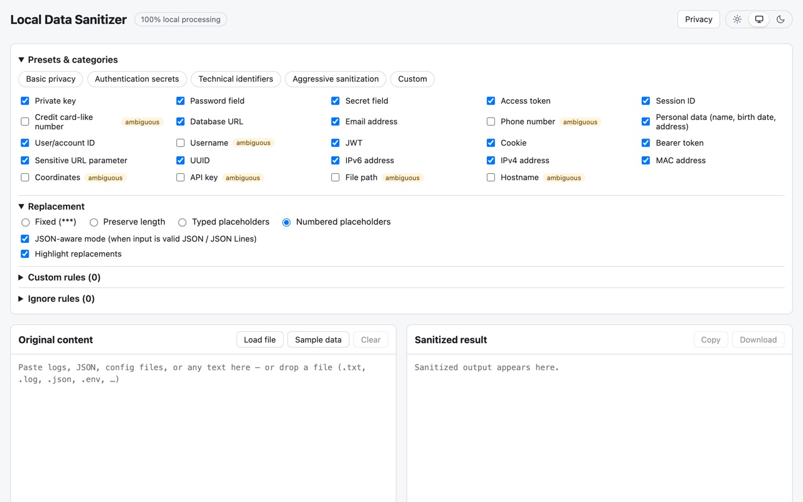

<a href="https://mifwar.com">
<picture>
  <source media="(prefers-color-scheme: dark)" srcset="assets/header-dark.svg">
  
</picture>
</a>

<kbd>mifwar</kbd>&nbsp; <a href="#tools">1:tools</a>&nbsp; <a href="#the-setup">2:setup</a>&nbsp; · &nbsp;<a href="https://mifwar.com">mifwar.com</a>

I'm Miftahul. I write frontend code at [Zenius Education](https://www.zenius.net), mostly Next.js. I got here through robotics: three years on the EROS team at PENS, where I wrote the robot monitor below.

Open to freelance web work: I've built [Surabaya Worker Support](https://sbyworkersupport.com) and [SurabayaBaru.id](https://surabayabaru.id). → [hi@mifwar.com](mailto:hi@mifwar.com)

<picture>
  <source media="(prefers-color-scheme: dark)" srcset="assets/field-dark.svg">
  
</picture>

### Tools

<table>
<tr>
<td width="33%" valign="top">
<a href="https://md.mifwar.com"><picture><source media="(prefers-color-scheme: dark)" srcset="assets/md-dark.jpg"></picture></a>
<b><a href="https://md.mifwar.com">Live Markdown</a></b> · browser 
Markdown and Org with a live preview. Exports HTML, DOCX and PDF.
</td>
<td width="33%" valign="top">
<a href="https://uqur.mifwar.com"><picture><source media="(prefers-color-scheme: dark)" srcset="assets/uqur-dark.jpg"></picture></a>
<b><a href="https://uqur.mifwar.com">Uqur</a></b> · browser 
Measure and annotate UI screenshots without opening Figma.
</td>
<td width="33%" valign="top">
<a href="https://scrub.mifwar.com"><picture><source media="(prefers-color-scheme: dark)" srcset="assets/scrub-dark.jpg"></picture></a>
<b><a href="https://scrub.mifwar.com">Local Data Sanitizer</a></b> · browser 
Strip tokens, keys and emails from logs before pasting them into AI.
</td>
</tr>
</table>

Also: [Key Bee](https://github.com/mifwar/key-bee) · [crew](https://github.com/mifwar/crew) · [Live CSV](https://csv.mifwar.com) · [Port Patrol](https://github.com/mifwar/port-patrol) · [Brat Text](https://bratt.netlify.app) · [pash](https://github.com/mifwar/pash) · [wt](https://github.com/mifwar/wt) · [opengraph-viewer](https://github.com/mifwar/opengraph-viewer) · [spotify-lyrics-menubar](https://github.com/mifwar/spotify-lyrics-menubar-swift) · [pi-sounds](https://github.com/mifwar/pi-sounds)

### The setup

[My dotfiles](https://github.com/mifwar/dotfiles): tmux with several coding agents side by side, yabai, Neovim (LazyVim), Ghostty, Catppuccin everywhere.

  <picture>
    <source media="(prefers-color-scheme: dark)" srcset="assets/sigil-dark.svg">
    
  </picture>

[mifwar.com](https://mifwar.com) · [hi@mifwar.com](mailto:hi@mifwar.com) · [@mif_war](https://x.com/mif_war)
